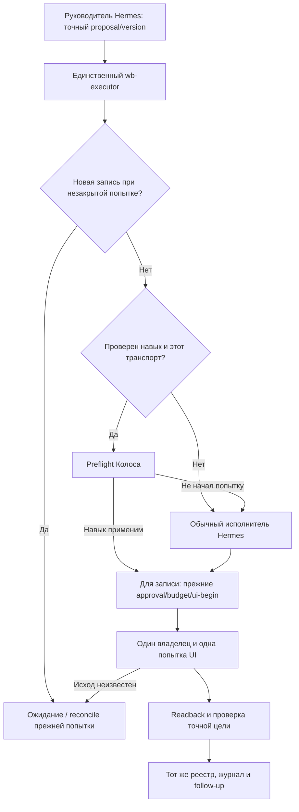

# Колос как подисполнитель существующего Hermes

Проверка 12 ноября 2026 года. Рекомендация: **один владелец исполнения
`wb-executor-101`, общий реестр и специализированные навыки Колоса внутри него**.
Руководитель продолжает выбирать деловое действие. Детерминированный распределитель
проверяет освоенность точной операции и браузерного транспорта. Доступная процедура
может идти в Колос; остальные задачи остаются обычному исполнителю Hermes.

Подготовлен **локальный shadow-прототип**, не подключённый к рабочим чатам,
расписаниям, рекламному кабинету или изменению основного реестра. Каждый его ответ
содержит `may_execute:false` и `mode:shadow_only`. Инвентаризация и проверки
не предоставляют денежных полномочий.

Прототип маршрутизирует структурированные предложения из снимка реестра. Тексты
нативного чата используются для аудита; автоматического преобразования их в
разрешённые команды и отправки заданий здесь нет. В будущем обычный исполнитель
сначала формирует точный запрос навыку; для чистого чтения это отдельный task_id
с identity/полями, для изменения — ссылка на прежний proposal/version.

## Что фактически поручают исполнителю

Прочитан основной `wb_analitika/data/product_manager/state.json` одним снимком;
нативный Bot Chat профиля `wb-executor-101` прочитан через SQLite `mode=ro`,
`query_only=ON`. Выбирались только пользовательские поручения и финальные ответы,
без системного промпта, reasoning, tool results, auth/config/env. Соединения закрываются
после чтения. Если canonical chat сжат в цепочку, этот reader останавливается:
для такой истории потребуется официальный reader с ancestry.

В каноническом чате найдены **4 содержательных поручения руководителя и 5
технических проверок переноса/доступа**. Сообщения лимита tool iterations не
считаются бизнес-задачами. Четыре поручения — input29→reply57,78→100,101→126,
127→148. Их полные тексты и реальные ID сохранены только в локальных материалах.

Последние поручения связаны прежде всего с проверкой результата и настроек:

- дочитать DAY-лимиты, автопополнение, расписание и срок остановки кампаний;
- различать активную и архивную кампании, сохранять точные источники и пробелы;
- подтвердить старую паузу независимым WB-наблюдением после исходной попытки;
- оставить отложенным возврат кластера, пока необходимые ограничения не доказаны.

Это не четыре новых разрешения изменить рекламу. В последнем поручении руководитель
явно оставил возврат отложенным и запретил новые записи.

В снимке общего реестра — 15 предложений, из них 12 относятся к XWAY:

| Операция | Всего | Фактические статусы в реестре |
|---|---:|---|
| Исключить/вернуть кластер (`set_excluded`, bool) | 10 | 6 verified,1 failed,3 proposed |
| Удержание позиции кластера с максимумом CPM | 1 | proposed |
| Пауза кампании | 1 | verified в финальном срезе |
| Цена, вне этой интеграции | 3 | 2 verified,1 pending_verification |

Verified-история кластеров относится к прежним исполнениям до переноса в Hermes;
это не статистика успешности нынешнего нативного исполнителя. Действующая политика
также перечисляет start/pause, ручной bid, бюджет, расходный лимит и расписание.
Наличие команды в протоколе не означает проверенный навык Колоса.

## Конкретные текущие ограничения

Финальный снимок реестра снят17:55МСК12.11; точное время и хеш — в сводке.
В начале аудита канал занимала старая пауза по одному товару.
Пока шла наша работа, параллельный процесс обновил подтверждение по прямому
поручению владельца: пауза получила verified, общий lock освобождён. Это изменение
выполнено вне Колоса и не является результатом данного shadow-прототипа.
Финальное распределение:7 завершённых→не исполнять повторно;1 закрытая неудача→разбор;
3 цены→прежний серверный маршрут;4 новых XWAY-preview→обычный исполнитель Hermes
для прежних проверок. Это кандидат на обработку, не разрешение применить proposal;
явное defer и отсутствие согласия по-прежнему запрещают запись.
Чистое чтение при этом допустимо через того же владельца с последовательным
доступом к UI: pending-запись не запрещает собирать доказательства и читать другие
настройки. Распределитель не резервирует для такого чтения вторую попытку записи.

Дополнительно проверены первичные сохранённые материалы, а не только ответы бота:

- В DOM12.11 архивной кампании25456147 нужные управляющие кнопки имеют
  `disabled:true`; в частности, кнопка расписания находится в контексте «Всегда».
  Это наблюдение конкретной архивной строки, не вывод об отсутствии функций во всём XWAY.
- Прежний сохранённый независимый WB-результат для28605939 содержит статус «Приостановлена»
  и `observed_on=2026-11-11`, без времени. Его хеш совпадает с сохранённой проверкой.
  Дата не доказывает наблюдение после submitted11.11 11:04:37.685208МСК;
  время сегодняшнего чтения не заменяет первичную метку WB.

Недостаток временной метки был причиной прежней pending-проверки, но **не является
действующим блокером этой паузы**. Актуальный процесс wb-product-execute1.4.2 и
ui_execution.reconcile допускает подтверждение полной паузы в XWAY. В финальном
реестре verification_scope=xway, наблюдение11.11 11:06:30МСК после submitted,
campaign_status=paused и подпись «Приостановлена». Источник уточнения —
`wb_analitika/data/product_manager/hermes/pause-process-20261112/owner-source.json`.
Полную приостановку нужно отличать от временной паузы AI/расписания; Колос должен
использовать текущий штатный контракт, а не старые требования из истории чата.

Новый исполнитель сам по себе не устраняет недоступный control или недостаточную
метку источника. Он должен вернуть точный пробел либо применить актуальное
правило проверки, сохраняя того же владельца и попытку. Наш инструмент не вызывал
reconcile и не редактировал главный реестр.

## Где подключать Колос



Сохраняются `proposal_id/version`, identity, campaign/query, точный payload,
preconditions, срок и источник решения руководителя. Колос не выбирает рекламную
гипотезу, не создаёт второй резерв/чат, не продлевает политику и не заменяет
существующий `actions.check_execution` / `ui-begin` / `ui-reconcile`.

Переключение в Hermes допускается только при **preflight до ui-begin**:
нет attempt_id, выданного may_interact, отправленной записи, неизвестного Save
или удерживаемой блокировки. Хеш всего исходного задания должен совпасть.
После резерва/первого возможного autosave — только прежняя попытка и reconcile;
передать ей другого наблюдателя можно, разрешить вторую запись нельзя.

«Сначала всё Колосу» имеет смысл только как дешёвая проверка реестра навыков.
Заведомо неизвестный тип сразу получает обычный исполнитель; нет необходимости
запускать пробную UI-последовательность. Каждый новый навык добавляется в
положительный список после своей проверки.

## Готовность навыков

| Процедура | Подтверждённый уровень | Текущий маршрут Hermes |
|---|---|---|
| Найти товар и прочитать артикул/WB ID/бюджет | Живой тест11.11 во встроенном браузере Codex | Обычный Hermes, пока не проверен адаптер Яндекса |
| Исключить/вернуть кластер | Проверена локальная реконструкция контракта | Обычный Hermes; Колос только в rehearsal |
| Читать формы DAY/autofunding/schedule/expiry | Отдельный навык Колоса не обучен | Обычный Hermes |
| Position hold, bid, budget, spend limit, schedule, start/pause | Живое исполнение Колосом не проверено | Обычный Hermes и прежние проверки |

Ключ capability включает **операцию и транспорт**: успех в Codex IAB не
включает исполнение в `hermes_yandex`, а `replay_only` не превращается в
`live_write_verified`. В имеющемся реестре нет выданного Колосу права записи.

## Повторные проверки цели

Загружена прежняя замороженная память `cluster-replay-20261111/learned.json`.
Её учебный возврат исключён из проверки. Отложены8 задач на6 товарах:
5 ранее проверенных исторических переходов и3 новых для этого прогона preview
на2 других товарах. Для preview целевой after **имитируется**, не выдаётся за
факт применения. Реальные прошлые разрешения не используются; локальный host
имеет явное синтетическое разрешение и блокирует сеть.

На каждую задачу: штатный путь и8 помех — другая identity, отсутствие разрешения,
уже достигнутая цель, неоднозначное поле, устаревший readback, Save без эффекта,
потерянная квитанция, изменение scope после begin. Колос и обычный скрипт получают
одинаковые условия. Для цели дополнительно используется замороженный **существующий
`wb_analitika/src/services/product_manager/ui_policy.py:matches`**, а не только
статус ядра. Это проверка результата, не замена полного денежного gate приложения.

| Проверка | Колос | Скрипт |
|---|---:|---:|
| Штатные цели подтверждены | 8/8 | 8/8 |
| Правильные исходы с помехами | 64/64 | 64/64 |
| Всего исходов | 72/72 | 72/72 |
| Ложный успех / повторный Save | 0/0 | 0/0 |
| Вызовы модели | 0 | 0 |

Дополнительно: отключение выученной связи блокирует8/8 задач до Save; свежий
интерпретатор выполняет8/8 с тем же хешем памяти. Всего144 испытания (72 пары) плюс
8 контролей памяти и8 повторов после перезапуска. Сам тест не доказывает
превосходство Колоса над скриптом и не является проверкой живых рекламных форм.

34 unit/regression-теста пройдены. Проверены запрет позднего fallback, неизменность
proposal/version/payload при передаче, отсутствие мнимого разрешения у shadow-ответа,
различение транспорта, read-only чтение SQLite, привязка финального ответа к запросу,
недостаточность «complete» без независимой цели. Валидатор подтвердил все пары,
контроли, перезапуск, хеши кода/памяти и сохранённых первичных источников.
Исторические записи живого read-only опыта11.11 также повторно провалидированы;
новых живых действий этот аудит не выполнял.

## Файлы и воспроизведение

- `kolos_states/hermes_shadow/audit.py`: чтение реестра и нативного чата без запуска бота.
- `routing.py`: чистое решение о маршруте и ограничение передачи до резерва.
- `replay.py`: повтор процедур через прежний StateEngine и независимую проверку цели.
- `__main__.py`: CLI аудита/restart, выход только в новый каталог tests/desktop-output.
- [Проверяемая техническая сводка](evidence/hermes-shadow-20261112.json).
- [Полные тексты поручений и ответов, локально](../tests/desktop-output/hermes-shadow-20261112-final/executor-messages.json).
- [Решения распределителя](../tests/desktop-output/hermes-shadow-20261112-final/routing.json).
- [Все результаты rehearsal](../tests/desktop-output/hermes-shadow-20261112-final/replay.json).

```powershell
py -3 -X utf8 -B -m unittest tests.desktop.test_hermes_shadow tests.desktop.test_cluster_replay tests.desktop.test_cluster_adaptation
```

Первый аудит запускался через `python -m kolos_states.hermes_shadow audit` с
точными --state/--executor-db/--memory/--goal-policy и новым --output. После него
`python -m kolos_states.hermes_shadow restart --output <тот же каталог>` выполняет
только локальные проверочные задачи в новом интерпретаторе. Полные исходные
бизнес-данные, тексты чата и снимки реестра остаются вне Git в tests/desktop-output.

## Условия следующего подключения

1. Подключить тот же механический протокол к штатному `browser_exec` Hermes
   в его Яндекс-профиле, сохранив одного владельца браузера. Не переносить
   cookies/секреты и не создавать второго рекламного исполнителя.
2. Сначала обучить и записать read-only навыки поиска, чтения точного кластера
   и настроек кампании. Повторить на нескольких товарах, проверить disabled,
   отсутствующую модаль и отключённую память. Требовать реальные поля/единицы,
   а не узнавание формы только по заголовку.
3. Для каждого навыка изменения отдельно пройти локальные помехи и проверенный
   живой proposal по действующему разрешению и при свободном канале исполнения.
   Контролировать цель и остальные настройки по readback; не использовать
   старое may_interact после перезапуска.
4. Только затем включать этот exact capability в боевом распределителе и
   сравнивать токены, долю завершённых целей и труд исправления интерфейса с
   прежним исполнителем. Текущий shadow-прототип ничего из этого не активирует.

Труд и расходы полного Hermes-цикла здесь не измерялись. Доказано выполнение
знакомой локальной процедуры без модели и зависимость от выученного графа.
Экономию всей системы и автоматическое дообучение из ошибок пока не заявляем.

Изменения нашего инструмента изолированы в Колосе. Он не писал в WB Аналитику,
профили Hermes, конфигурацию, чаты, расписания или боевой ledger и никому не
отправлял сообщения. Работающая параллельно система обновляла свой реестр;
финальный снимок и выводы учитывают её новую версию.
Существующий learner оставлен прежним, выделены аудит, маршрутизация и rehearsal;
новых зависимостей и коммитов нет.
